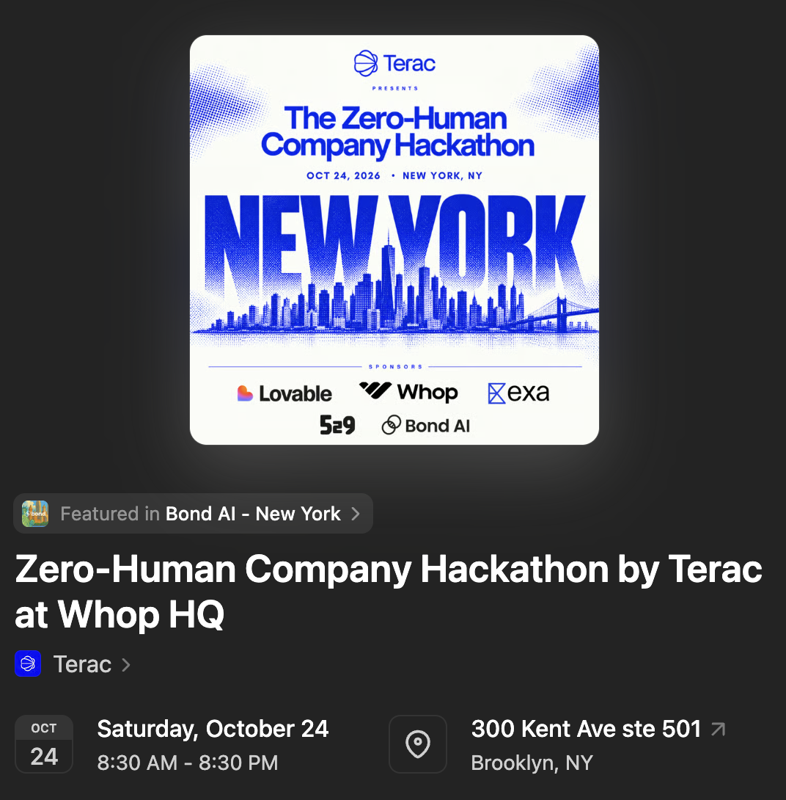
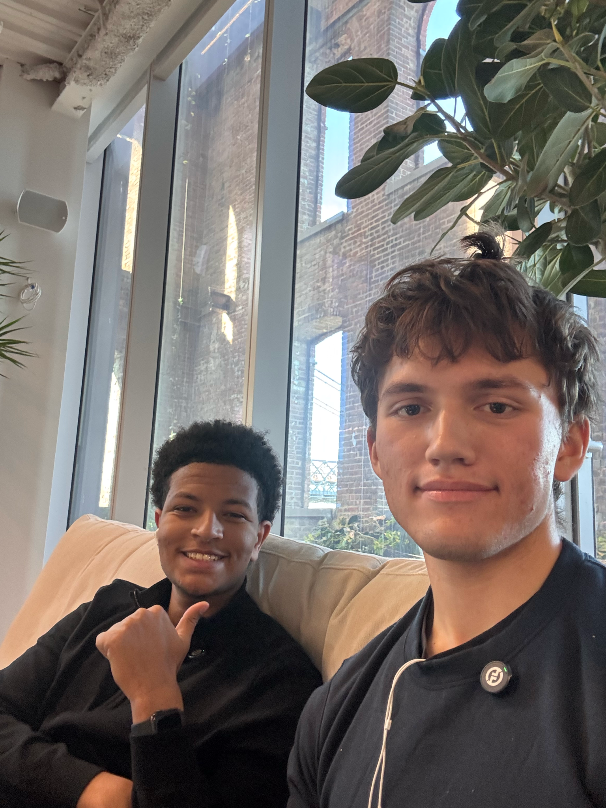
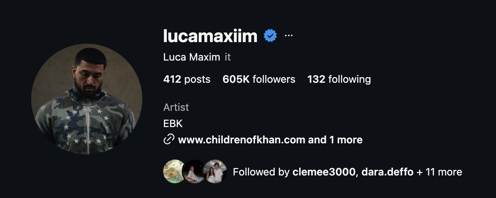
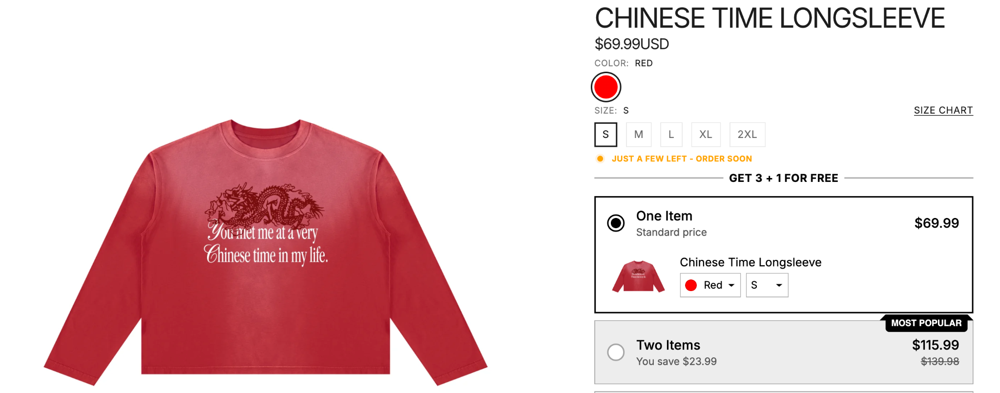

# AI UGC outreach PDF template

Use this template to create a personalized PDF for each brand Ryan chooses to contact. Preserve Ryan's approved copy and visual style. Change only the variables listed below. Preparing a PDF does not send outreach.

## Approved reference

- Final approved example: [Award Scholar proposal v10](reference/AwardScholar_Proposal_v10.pdf).
- [Page 1 preview](reference/page-1.png) and [page 2 preview](reference/page-2.png).
- Native Google Docs master: https://docs.google.com/document/d/1P7lJ33KhKspIkq-ick8k2oti9lR8aeAfxXDX2xCTuBg/edit
- Public example PDF: https://drive.google.com/file/d/1E9_e5iysCHNjizI0BhH3b903sWagunPb/view
- Native content and formatting snapshot: [native-document.json](reference/native-document.json).
- Reference approved October 24, 2026. Keep all earlier files and master documents intact.

## Non-negotiable rules

- Two content pages maximum. Page 1 ends with the promise line. Page 2 starts with the large offer headline.
- Use Ryan's exact copy below. Do not rewrite, polish, add concepts, or add personalized sales paragraphs.
- Keep the offer at **10 High-Converting AI UGC ads**, the $1,000 normal price, $500 offer, and existing guarantee unless Ryan explicitly changes them.
- Keep the first-page logo horizontally centered at the top.
- Use actual brand ad images, never another brand's images or generated substitutes.
- Preserve the example video, creator proof, brand proof, hackathon images, and their links.
- Do not add em dashes or emojis to the copy.
- Workflow notes, variable tables, source notes, and preview labels are instructions. They never appear in the PDF.

## Variables

| Variable | Approved example | Rule |
| --- | --- | --- |
| `{{BRAND_NAME}}` | Award Scholar | Use the verified brand spelling consistently. |
| `{{BRAND_POSSESSIVE}}` | Award Scholar’s | Used only in the ad caption. |
| `{{BRAND_LOGO}}` | assets/example-brand-logo.png | Replace with the official website logo or verified Instagram profile picture. |
| `{{BRAND_AD_1}}` | assets/example-brand-ad-1.png | Replace with the target brand's actual ad image. |
| `{{BRAND_AD_2}}` | assets/example-brand-ad-2.png | Replace with a second actual ad image. |
| `{{AD_1_SOURCE_URL}}`, `{{AD_2_SOURCE_URL}}` | See research notes | Store the permanent Meta Ad Library links in the research record, outside the PDF copy. |
| `{{DEADLINE_TIME}}` | 6:30 PM | Must agree with the short time below. |
| `{{DEADLINE_TIME_SHORT}}` | 6:30 | Same deadline, short form in the CTA. |
| `{{EVENT_DATE}}` | October 24, 2026 | The word "today" must remain truthful for the intended send date. |

Before reuse on another day, confirm the event, deadline, and hackathon discount reason with Ryan. The current copy is specific to October 24, 2026. Do not silently send the expired "today" wording or invent a replacement story. Leave all other words unchanged.

## Exact PDF copy: page 1

<!-- The logo is the first visible item, centered, 40 x 40 pt. -->

Hey {{BRAND_NAME}} team,

My name is Ryan, and I’m a content creator ([account #1](https://www.instagram.com/ryancortenbach/), [account #2](https://www.instagram.com/ryannnfromschool/)) & Columbia Engineering Student ([linkedin](https://www.linkedin.com/in/ryancortenbach/?isSelfProfile=true) lol)

I’m currently at a Whop Hackathon & **our goal is to make as much money as possible with AI til {{DEADLINE_TIME}} today, {{EVENT_DATE}}.**

<!-- Put these two images side by side, as in the approved reference. -->
 

[(the hackathon luma link)](https://luma.com/naxtga5l?tk=SthOmH)                 (me & my boy currently @ the hackathon)

I know you run ads for {{BRAND_NAME}}, and **I can help create lots of high quality ads for your brand.**

Here’s a piece of content we made targeting 18-21 year old Londoner’s interested in football, Wingstop, and streetwear: [PS2_penthouse_FINAL_v4.mp4](https://drive.google.com/file/d/1UPSjg8V8ZgMfd0fgjmf4HCJUdURt7c6S/view?usp=sharing)

(fully made w/ AI btw, selling a general hoodie found on Amazon)

<!-- Put both ad images side by side and the caption beside them, matching the reference. -->
    (I’ve seen {{BRAND_POSSESSIVE}} ads)

<!-- One-line separation above. Bold, 14 pt. Last textual line of page 1. -->
**Here’s the promise I’ll make for {{BRAND_NAME}} ->**

<!-- HARD PAGE BREAK. Never move the offer onto page 1 or the promise onto page 2. -->

## Exact PDF copy: page 2

<!-- 36 pt bold. Only "10" is red. Preserve the approved compact headline spacing. -->
**We’ll create 10 High-Converting AI UGC ads for {{BRAND_NAME}}.**

<!-- 18 pt bold gray. Underline only "100% Money Back Guarantee". -->
**(& If you don’t like them, <u>100% Money Back Guarantee</u>)**

Normally, I’d sell this service for $1,000

But because I’m at this hackathon, I’ll do it for **$500**

<!-- "LMK ASAP!" is bold red, 14 pt. The remainder stays body text in this same paragraph. -->
**LMK ASAP!** Gotta build this by {{DEADLINE_TIME_SHORT}}. Full Money Back Guarantee if you don’t like results. Willing to work on your project as long as necessary too. Preciate you taking the time.

<!-- Keep the regular paragraph separation, plus two additional blank lines before the proof introduction. -->

And if you need more proof…

Here’s a creator ripping the same content whose made $100K in sales for his brand & does >1M views per month with AI ads like mine: [link to account](https://www.instagram.com/lucamaxiim/), [link to brand](https://www.childrenofkhan.com/?utm_source=ig&utm_medium=social&utm_content=link_in_bio&fbclid=PAZXh0bgNhZW0CMTEAcGRvZgJzcnRjBmFwcF9pZA85MzY2MTk3NDMzOTI0NTkAAacCUniH7a2UoiN6-1ig-5d3DprplkHbDV0NRzrIvX8j8gMCDUvdpj9Pp_dMhg_aem_tDuWwjDAxajsOEA7EJQl-A)

<!-- Preserve the original creator screenshot, then the full-width brand/product screenshot below it. -->

## Layout specification

Plain Markdown does not preserve point sizes, colors, image placement, or blank-line height reliably. Copy the native master before editing, or reproduce its styles using the retained snapshot and rendered reference. Do not export this entire instruction file as a PDF.

| Element | Approved formatting |
| --- | --- |
| Paper | US Letter, 612 x 792 pt, portrait |
| Margins | 54 pt on all sides |
| Body | Arial, 11 pt, black, 115% line spacing |
| Normal paragraph gaps | 8 pt blank paragraphs, 100% line spacing |
| Logo | 40 x 40 pt, centered, first visible item, 8 pt below |
| Hackathon emphasis | "our goal is to" through the date is bold, 14 pt; "make as much money as possible with AI" is red |
| Event image | 169.125 x 172.3261 pt |
| Teammate image | 114.0524 x 152.3668 pt, beside event image |
| Ads | Two portrait previews, each 100 x 177.7778 pt; preserve aspect ratio for different source dimensions |
| Image paragraphs | 100% line spacing |
| Hackathon paragraph and AI-example note | 8 pt space below |
| Ad caption | "(I’ve seen {{BRAND_POSSESSIVE}} ads)", 11 pt, beside ad images |
| Promise | Bold, 14 pt, black, 11 pt space above in addition to the regular gap; last textual line of page 1 |
| Offer headline | Bold, 36 pt, 80% line spacing; "10" red, remaining text black |
| Guarantee | Bold, 18 pt, gray (#666666), 80% line spacing; guarantee phrase underlined |
| Offer price | "$500" bold, 16 pt |
| CTA | "LMK ASAP!" bold, 14 pt, red; rest of paragraph Arial 11 pt |
| Before proof introduction | Existing 8 pt blank paragraph plus two extra 11 pt blank paragraphs at 100% line spacing |
| Creator proof image | 243.375 x 96.7636 pt |
| Brand proof image | 468 x 184 pt, beneath creator proof |
| Links | Preserve blue underlined hyperlinks and the clickable video link |

Longer brand names may wrap differently. Adjust blank spacing or image size only as needed to stay within two pages. Keep all copy, pictures, colors, font hierarchy, and the required page break. Inspect both rendered pages after any adjustment.

## Brand research and generation procedure

1. Copy the native master into a new brand-specific document. Never change the approved master or a previous recipient's document.
2. Verify the target brand's website and Instagram handle. Prefer the verified Instagram name when finding the advertiser; do not assume a guessed handle.
3. Download the official logo or Instagram profile picture. Center it at the top of page 1.
4. Find two actual Meta ads for that advertiser. Match the brand's landing domain and advertiser identity. Capture the creative images and keep permanent ad URLs in a separate research record.
5. Award Scholar lookup precedent: a domain-only search returned zero results. Exact brand-name search "Award Scholar" worked. Successful actor input was `{"search":"Award Scholar","country":"US","active_only":true,"max_ads":2}` for Apify actor `s-r/meta-ads-library`. Reuse this as a discovery method, never as evidence for a different brand.
6. The approved Award Scholar pictures are video preview images from Ad Library listings, not full browser screenshots and not proof of Marketplace placement. Describe future captures accurately in research notes.
7. Fill the brand variables and confirmed timing variables only. If no real ads can be found, do not leave Award Scholar assets in another brand's PDF or claim "I know you run ads" without evidence. Ask Ryan how he wants that case handled.
8. Preserve the fixed sample video and proof images. The sample audience describes Ryan's example video, not the recipient's demographic.
9. Export to PDF. Google Docs may prepend a synthetic tab-title cover. Remove only that synthetic cover, after checking it contains no actual document content.
10. Verify exactly two content pages, no clipped text, all seven intended images, the centered logo, page 1 ending with the bold 14 pt promise, and page 2 starting with the 10-ad headline.
11. Verify only intended variables changed, all hyperlinks work, and no previous brand names or unresolved placeholders remain.
12. Save as `{{BRAND_SLUG}}_AI_UGC_Proposal_v1.pdf`. Use the next version for revisions. Upload to Ryan's personal Drive, `cortenbach.ryan.23@gmail.com`, when requested. For a publicly shareable PDF, verify anyone-with-link reader access before returning its direct link.
13. Return the PDF and its direct link for the authorized outreach workflow. Template creation alone does not authorize sending it to anyone.

## Award Scholar example research

- Website/logo source: https://www.awardscholar.com/logo-navbar.png
- Verified landing domain: https://www.awardscholar.com/
- Ad 1: https://www.facebook.com/ads/library/?id=1798011228292318
- Ad 2: https://www.facebook.com/ads/library/?id=2962095170805548
- Creator profiles associated with these ads: @sadiescholar and @petuhparkuh; the second caption tagged @awardscholar.
- Existing discovery notes: /Users/ryancortenbach/Documents/Codex/2026-10-24/awardscholar-ad-research-v1/HOW-ADS-WERE-FOUND.md
- This folder contains example brand assets for reference. Replace the logo and both ad images for every new recipient.
